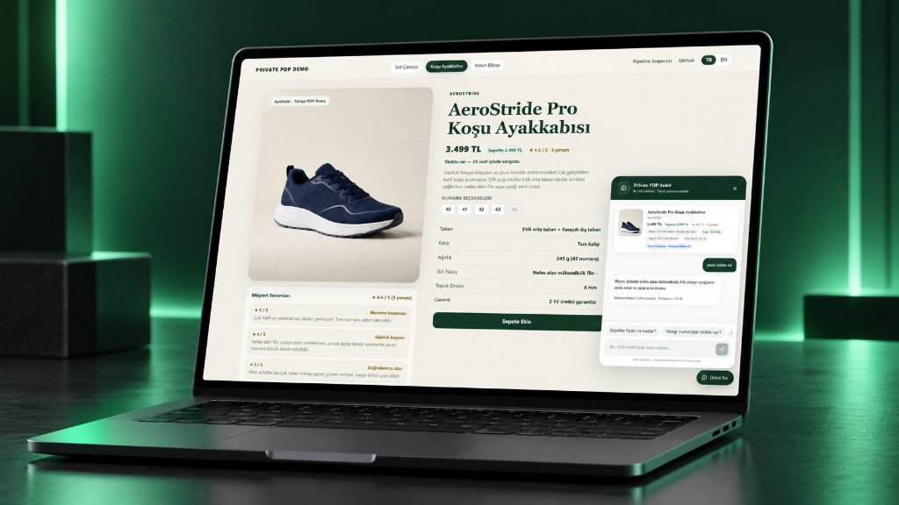
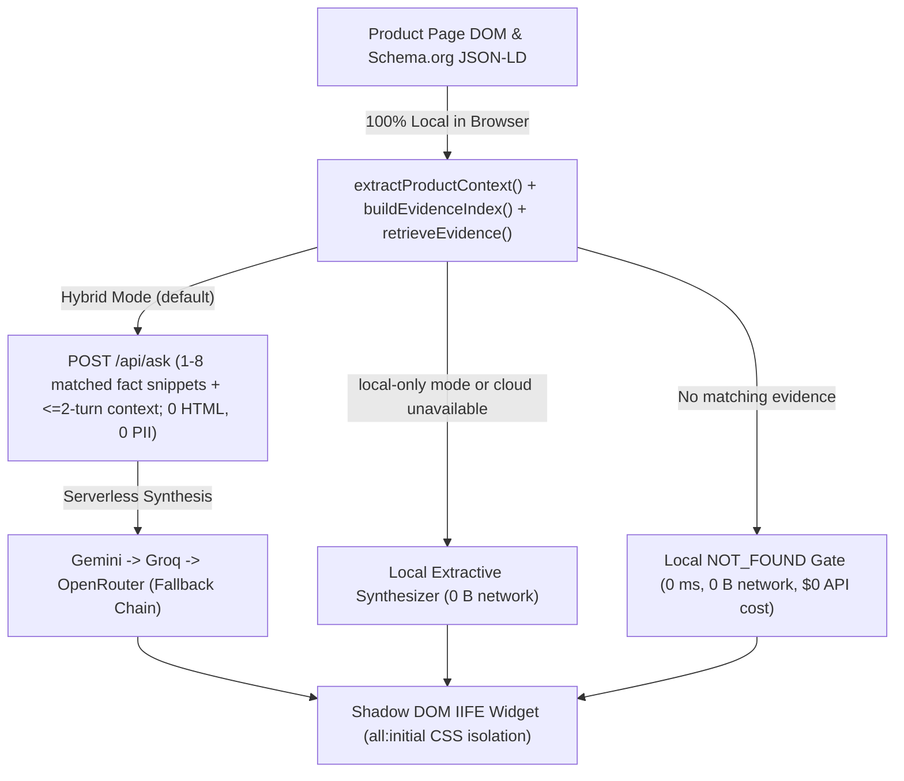
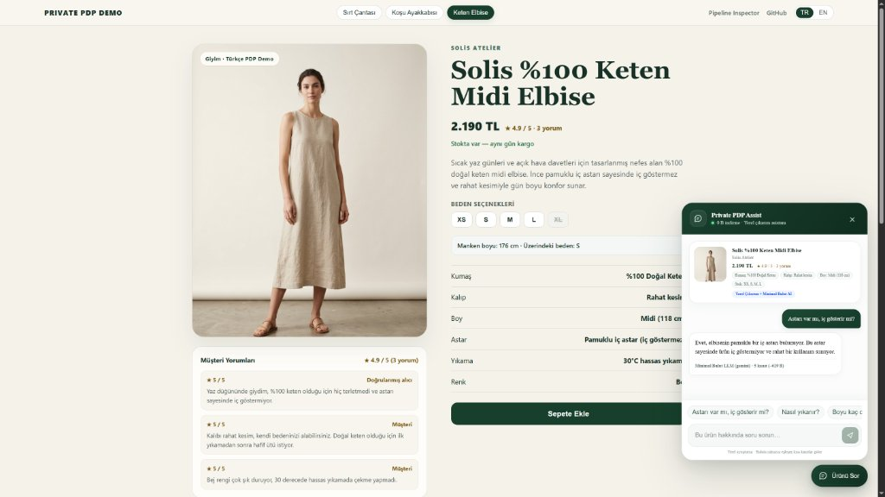
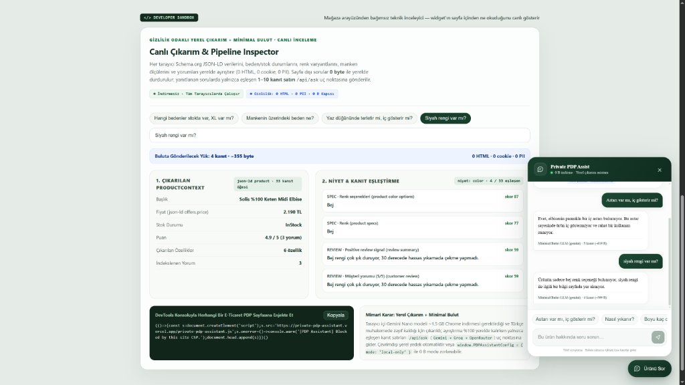

# Private PDP Assistant — Privacy-First Product Page AI Widget

A category-agnostic, privacy-first e-commerce product assistant built with **TypeScript, Shadow DOM, and Vite IIFE** (zero runtime npm dependencies) paired with a minimized-evidence serverless synthesis endpoint (`api/ask.ts`).

**[Live 3-Category Demo & Inspector](https://private-pdp-assistant.vercel.app)** · **[Portfolio Case Study](https://kadircelikportfolyo.vercel.app/#projects)**



---

## Architecture

Instead of shipping raw page HTML, session cookies, or shopper PII to a backend, Private PDP Assistant runs **all DOM/JSON-LD extraction, intent detection, Turkish/English suffix-stripped retrieval, and out-of-page gating locally in the browser**:



---

## Key Engineering Highlights & Trade-Offs

### Why We Dropped On-Device Gemini Nano (Architecture Decision)

This project originally prototyped Chrome's experimental Prompt API (Gemini Nano) + Translator API for 100% on-device inference. Benchmarking across real Turkish and English product pages surfaced four structural trade-offs for real shoppers:

1. **Conversion-killing ~1.5 GB model download & poor browser support:** Unavailable on Safari, Firefox, mobile browsers, and most Chrome sessions without manual opt-in.
2. **Low small-model reasoning accuracy:** Prone to truncation, false negatives on inflected queries, and prompt/quota exhaustion (`QuotaExceededError`).
3. **TR ↔ EN Translator bridge distortion:** Chrome Prompt API rejected native Turkish output, forcing two-way translation (`tr -> en -> Prompt -> tr`) that corrupted domain phrasing (*kalıp*, *astar*, *baza*).
4. **Simpler, higher-precision privacy model:** Running extraction, scoring, and `NOT_FOUND` gating locally — and sending **only matched short evidence strings** (~200–1,100 B, zero HTML, zero cookies, zero PII) — preserves data minimization while working instantaneously in every browser.

### Core Capabilities

- **Cross-Storefront Extraction (`src/extractor.ts`)**: Prioritizes Schema.org `Product` / `ProductGroup` / `Book` / `AggregateOffer` JSON-LD (with HTML-entity decoding and `hasMerchantReturnPolicy` support), alongside split containers, collapsed accordion spec tables, DIV/P attribute lists, basket discounts, ratings, and reviews while excluding assistant and carousel/nav chrome.
- **Zero-Noise Local Retrieval & Follow-Up Memory (`src/retrieval.ts`)**: Detects TR/EN shopping intents (`price`, `dimensions`, `fit`, `care`, `material`, `color`, `delivery`, `returnPolicy`, `reviews`, `suitability`, `summary`), handles Turkish suffix stripping + consonant de-mutation, supports compound multi-attribute queries, and resolves bounded 2-turn follow-ups (`"Peki neden?"`, `"Explain more"`) without relaxing out-of-page `0 B` `NOT_FOUND` gating.
- **Hardened Cloud Synthesis (`api/ask.ts`)**: Vercel serverless handler with 15 req/60s IP rate limit (`429`), 8 KB payload cap (`413`), strict JSON schema & HTML rejection (`400`), bounded `history` (`<= 4` turns), and `Gemini -> Groq -> OpenRouter` fallback.
- **Embeddable Shadow DOM Widget (`src/ui.ts`, `src/main.ts`)**: Zero runtime npm dependencies, `all:initial` CSS isolation, keyboard focus trap, swipeable dynamic suggestions tailored per PDP, broken-image fallback, and SPA URL/DOM `refresh()`.

---

## Screenshots

| Live Apparel Page Widget | Evidence Inspector & Retrieval Trace |
| :---: | :---: |
|  |  |

---

## Configuration & DevTools Injection

Paste on any CSP-permissive product detail page from the browser DevTools Console:

```js
(()=>{const s=document.createElement('script');s.src='https://private-pdp-assistant.vercel.app/private-pdp-assistant.js';s.onerror=()=>console.warn('[PDP Assistant] Blocked by this site CSP.');document.head.append(s)})()
```

Optional runtime configuration before or after loading:

```js
window.PDPAssistantConfig = {
  mode: 'hybrid', // or 'local-only' (disables /api/ask calls completely)
  apiEndpoint: 'https://your-domain.example/api/ask',
}
```

Lifecycle & diagnostics API:

```js
PDPAssistant.refresh()
PDPAssistant.unmount()
PDPAssistant.mount()
PDPAssistant.debugContext()
PDPAssistant.debugEvidenceIndex()
PDPAssistant.debugRetrieveEvidence('Geniş taraklı ayağa olur mu?')
```

---

## Project Structure

```text
private-pdp-assistant/
├── api/
│   └── ask.ts              # Minimized-evidence synthesis endpoint (rate limit, 8 KB cap, LLM chain)
├── public/products/        # 3-category demo product imagery & icons
├── src/
│   ├── extractor.ts        # JSON-LD + DOM product spec, pricing, variant & review extractor
│   ├── fallback.ts         # Category-agnostic local extractive synthesizer
│   ├── main.ts             # IIFE bootstrap, config API & Shadow DOM mounting
│   ├── retrieval.ts        # TR/EN intent detection, Turkish stemmer & 2-turn follow-up memory
│   ├── styles.ts           # Encapsulated Shadow DOM styles
│   ├── types.ts            # Shared evidence & configuration interfaces
│   └── ui.ts               # Accessible Shadow DOM chat widget & inspector hooks
├── tests/
│   └── core.test.ts        # Node native test runner + jsdom unit suite
├── index.html
├── package.json
├── vercel.json
└── vite.config.ts
```

---

## Local Setup & Verification

```bash
npm install
npm test        # Node native test runner + jsdom
npm run build   # Builds dist/private-pdp-assistant.js + dist/index.html
npm run dev     # Local Vite dev server
```

To enable Cloud Synthesis locally or in production, run via `vercel dev` / Vercel with `GEMINI_API_KEY`, `GROQ_API_KEY`, and/or `OPENROUTER_API_KEY`. When no API keys are set, `/api/ask` returns `503` and the widget automatically falls back to `Offline Local Mode`.
